<p align="center">
  <picture>
    <source media="(prefers-color-scheme: dark)" srcset="docs/logo/skiff-logo.svg">
    
  </picture>
</p>

<p align="center"><b>A six-track groovebox firmware for the M-VAVE FM-1 and SMK-37 Pro</b><br>
synths and drums, patterns and songs, live performance, and a screen that shows what every control does</p>

<p align="center">
  <a href="https://github.com/illuminus5/skiff/releases/latest"></a>
  <a href="LICENSE"></a>
  
</p>

<p align="center"><b>New in 2.0.2:</b> notes up to 128 steps long, the way back to the official firmware takes V16 too,
and fixes from your issues ·
<a href="https://github.com/illuminus5/skiff/releases/tag/v2.0.2">the release notes</a><br>
<b>New in 2.0.1:</b> fixes from your issues: FM6 sounds from DX7 banks no longer crackle, OCT+ in the
EDIT layer turns every drum lane back on, and the editor finds the unit on a Mac too ·
<a href="https://github.com/illuminus5/skiff/releases/tag/v2.0.1">the release notes</a><br>
<b>New in 2.0:</b> NOTES and FEEL, notes that overlap with lengths of their own, chains, songs
that play once and change sounds, drum lanes panned and your own drum kits, one mute and one MOD page, and new save
formats with room to grow ·
<a href="https://github.com/illuminus5/skiff/releases/tag/v2.0">the release notes</a><br>
<b>New in 1.4:</b> Skiff on M-VAVE's <a href="SMK37.md">SMK-37 Pro</a> keyboard, REST in SONG,
your own theme colours, each user sample's own level and sends, and an installer that carries on after a cut-off
install ·
<a href="https://github.com/illuminus5/skiff/releases/tag/v1.4">the release notes</a><br>
<b>New in 1.3:</b> the FM-1's second core (BETA: 12 voices), MIDI LEARN and a channel per track,
an INSERT effect, LFO sync, SPREAD and more from Felucca 1.6.1 ·
<a href="https://github.com/illuminus5/skiff/releases/tag/v1.3">the release notes</a></p>

<p align="center"><a href="https://youtu.be/c0HFI7AvN1M"></a><br>
<a href="https://youtu.be/c0HFI7AvN1M">▶ Watch the 1.3 tour on YouTube (3:38)</a></p>

<p align="center"><b>New to Skiff?</b> <a href="https://illuminus5.github.io/skiff/learn/">Learn Skiff</a>: the manual in chapters, each
with a video that shows every press on the unit. Start with <a href="https://illuminus5.github.io/skiff/learn/#first-beat">your first beat</a>.<br>
<b>Try it first:</b> <a href="https://illuminus5.github.io/skiff/try/">Skiff in your browser</a>, the firmware itself on a
drawn FM-1, played with the mouse, a touch screen or the computer keyboard.</p>

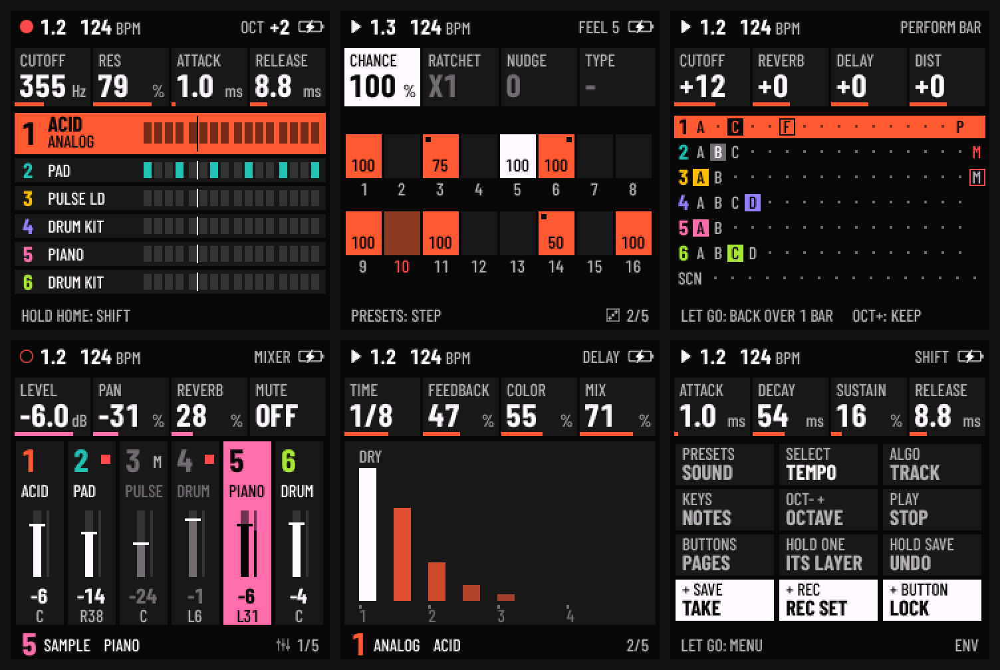

Skiff turns the FM-1 into a six-track groovebox: fourteen synth and drum engines with 148 factory sounds you can list
by type (only the basses, only the pads), a 64-step sequencer with chords, notes of any length that overlap, ratchets,
trig conditions and parameter locks, a shared pool of patterns played through per-track lists and scenes, and a
performance layer for launching it all live. Every page draws what its knobs do, and holding HOME shows what
every button, encoder and key does right there. FM6 sounds can be built from a bare sine on the unit itself, every
operator's envelope drawn as it plays and coloured by how bright the FM makes it. A browser editor reaches all of it
from a computer. The same firmware runs on M-VAVE's SMK-37 Pro keyboard, its pads a step grid and its faders a
mixer: [SMK37.md](SMK37.md).

Skiff is free software, a fork of [Felucca](https://github.com/hugelton/Felucca) 1.1.5 by Hügelton Instruments: it
keeps Felucca's engines, sound and file formats, so Felucca's sounds and projects load in Skiff. Skiff is not
Felucca: please report Skiff's behaviour [here](https://github.com/illuminus5/skiff/issues), not in Felucca's Issues.

## Install

Custom firmware, at your own risk; the way back to the official firmware is below.

**In the browser** (Chrome or Edge on a computer): open the [Skiff installer](https://illuminus5.github.io/skiff/webapp/installer/),
connect the FM-1 by USB and follow it. The same page takes the FM-1 back to the official firmware (V15 or V16: the
version it had before Skiff), saving a complete backup of your music first.

**With Python 3:** download `skiff-2.0.2.fwsc` from the [latest release](https://github.com/illuminus5/skiff/releases/latest)
and, with this repository's `tools/` folder,

```
pip install mido python-rtmidi
python tools/fm1_install.py skiff-2.0.2.fwsc
```

It takes about two minutes and the FM-1 restarts on Skiff.

**Back to the official firmware:** the installer page above, `python tools/fm1_install.py FM-1.fwsc` with M-VAVE's
file, or M-VAVE's own updater. An FM-1 that ran V16 before Skiff goes back to V16, one that only ever ran V15 to V15:
its start-up part decides, and the installer says which one it needs. M-VAVE's download page has given V16 since
October 21 (2.0.2: tried in the emulator only so far); V15 is in M-VAVE's
[fm1_open repository](https://github.com/m-vave/fm1_open) as `sdk/firmware/FM-1_015.fwsc`. The official firmware
writes its Bluetooth settings anew on its first start, so pair Bluetooth devices again if they don't connect.

**On the SMK-37 Pro:** the same installer finds the keyboard and picks its build (`skiff-2.0.2-smk37.fwsc` for
Python). Two steps come first: M-VAVE's firmware V016 on the keyboard, and a backup of its flash, which holds the
keyboard's own key calibration. [SMK37.md](SMK37.md#install) has both, the way back and what to do if it does not
start.

**Updating to 2.0** from Skiff 1.x or Felucca: 2.0 reads what Skiff 1.0 and later saved, and keeps it in newer
formats from then on. The installer page first takes a complete backup and saves it to your computer
(`Skiff-backup-DATE.json`: keep it, it is the way back). After the install it converts what 2.0 can't read as it
was (Felucca's projects and user sounds, DIGITAL sounds, the oldest formats) and writes only that back, with a list
of what it converted and of anything with no place in 2.0.
- `fm1_install.py` converts nothing. 2.0 shows a slot it can't read as OLD FORMAT and keeps it. In the Skiff Editor,
  take a backup and restore it: the Restore converts it.
- A project the converter couldn't give patterns to (the pattern pool full) also stays OLD FORMAT: free some in
  SAVE › PATTERNS, then take a backup and restore it.
- **The way back to 1.x:** install 1.4.x, then restore the dated backup in the Skiff Editor. 1.x doesn't read what
  2.0 saves: such projects and user sounds look empty there (their bytes stay until saved over), and its settings
  start at their defaults.

**Edit from a computer:** the [Skiff Editor](https://illuminus5.github.io/skiff/webapp/editor/) (Chrome or
Edge, over USB MIDI).

## At a glance

| | |
| --- | --- |
| **Tracks** | 6, each with its own engine, sound, sequence and mix; 8 voices shared between them, 12 with the second core (MENU › CPU 2 CORES, BETA, 1.3) (T5 and T6 play every engine but PHYS and GRAIN) |
| **Engines** | 14: ANALOG, FM6, PHASE, LOFI, SAMPLE, VOICE, TRIO, WHEEL, GRAIN, PHYS, NOISE, SLICE, DRUM, DRUM-X; 148 factory sounds, at least 8 an engine, each a BASS, LEAD, PAD, KEYS, PLUCK, DRUM or FX sound that SAVE › PRESETS lists by type; presets for all nine of DRUM's kits and eight DRUM-X kits among them; every value of an FM6 patch (6 operators, 32 algorithms) editable on the unit |
| **Sequencer** | 64 steps a track; LENGTH 1–64; 1/1 to 1/32, triplets, 2 and 4 bars a step; chords of up to 4 notes, each note its own length (1–99 % of a step, or 1 to 128 steps, past its pattern's end on into a chain's next part) and free to overlap the next; velocity, accent, slide; per-step chance, ratchet ×1–4 or FLAM, 12 trig conditions (FILL, !FILL, 1:2 … 4:4), NUDGE (−32 to +31 64ths of a step); swing, gate; FWD, RVRS, PING or RAND; ranges of steps edited as one, copy, paste and delete |
| **Recording** | live with overdub, FEEL (keeps where you played), count-in and click; step recording; TAKE keeps the last loop you played, after the fact |
| **Automation** | knob moves and parameter locks (hold a step, turn a knob), 64 records, listed and edited on SEQ › AUTOMATION |
| **Patterns and songs** | a pool of 64 patterns shared by every project; each track a list of 16 entries (A–P), each a pattern played 1–16 times, or chained into the next as one long pattern; SONG walks each track down its list, round and round or once |
| **Performance** | PERFORM: launch any track's entries and stage mutes on LOOP, BAR, BEAT or NOW; 16 scenes; throws (CUTOFF, REVERB, DELAY, DIST) that glide back, or stay; one mute a track on the black keys of GLO, FX and PERFORM (a tap latches it, held it cuts); the FX layer: repeat, reverse, filter sweeps, tape stop, freeze, harmonizer, gate, dub echo, flanger, vinyl |
| **Sound** | per track: an envelope (in milliseconds or note values) and a second one for modulation (ENV 2), an LFO (free or synced to the tempo), one MOD page for where they go (the LFO's four depths, the envelope's three, a 4-slot modulation matrix), DIST in five types (INSERT's SOFT, HARD, FOLD, CRUSH, FUZZ) with a TONE, an INSERT (drives, a bitcrusher, phaser, flanger, chorus) with MIX, the SLICER (16 patterns), DUCK (sidechain), SPREAD (the voices across the stereo field); a drum kit's lanes tuned, their decay set and (2.0) panned one by one; arpeggiator (14 modes), chord keys (9 chords, 5 voicings), 16 scales; MONO, LEGATO, UNISON, glide |
| **Effects** | chorus (CHORUS, FLANGER or PHASER, with FEEDBACK), delay and reverb (ROOM, SPRING or a stereo HALL) as sends |
| **Memory** | 4 projects, 32 user sounds, 3 user sample slots; the music comes back at power-on (RESTORE LAST); 8 levels of undo |
| **Screen** | 240 × 240 colour; a graph on every page; HOME held shows every control's job; 6 themes and colours of your own; LARGE mode with tall cards |
| **MIDI and USB** | USB MIDI in and out, TRS MIDI in; clock from inside, USB or TRS; each track its own channel (1–6 by default); MIDI LEARN for any knob; Program Change; a stereo USB audio input to record the master on a computer |
| **Editor** | in the browser: sounds, steps, the mixer, the song lists, scenes and pattern pool, projects, the DRUM-X kit, the settings, PLAY, STOP and REC |
| **Audio** | 44.1 kHz |

## A tour

### Find a sound by type

Every factory sound has a type: **BASS**, **LEAD**, **PAD**, **KEYS**, **PLUCK**, **DRUM** or **FX**. When a track needs
a bass, list the basses and step through them, across every engine, until one fits:

<table>
<tr>
<td width="40%">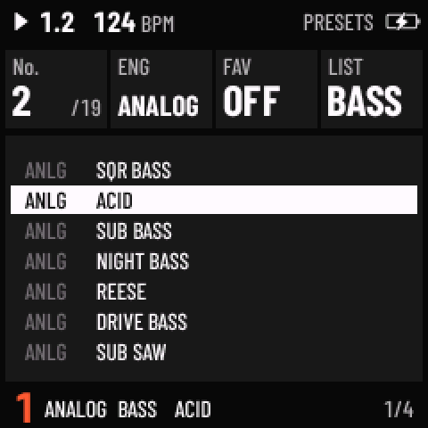<br><sub><b>LIST: BASS</b>: the basses of every engine, ENG saying whose each one is</sub></td>
<td>

1. **Pick the track** with ALGORITHM, say track 2.
2. **Tap SAVE** for SAVE › PRESETS (turn SELECT to it if another SAVE page opens) and turn **KNOB 4, LIST,** to
   **BASS**. The list now holds only the basses: 19 of them, from eight engines.
3. **Turn PRESETS** (or KNOB 1): each bass plays on the track as you reach it. One from another engine switches the
   track to that engine; its notes, its mix and its effects stay as they are.
4. **Stop on the one that fits.** Gone past the sound you had? **SAVE held** brings it back: a run of PRESETS turns
   is one undo.

</td>
</tr>
</table>

The LIST stays where you leave it, through a power-off too, and it is the unit's, not the track's. While it is on a
type, the PRESETS knob steps through that type on HOME and the sound pages too, and the footer says BASS beside the
engine, so you can browse from whichever page you are on. For track 3's pad: ALGORITHM to track 3, LIST to PAD. Back on
**ALL**, PRESETS steps through all 148 again.

- **FAV** lists your favourites. On SAVE › PRESETS, turn **KNOB 3, FAV,** right to mark the sound playing, left to
  unmark it. Your own sounds (SAVE › USER) are listed on ALL and FAV.
- **KNOB 2, ENG,** jumps to the next engine's first sound, whatever the LIST.
- Tracks 5 and 6 leave PHYS and GRAIN out of every list, since they don't play them: 18 basses there.

| Type | Sounds | From |
| --- | ---: | --- |
| BASS | 19 | ANALOG 7, FM6 4, LOFI 2, TRIO 2, PHASE, VOICE, WHEEL, PHYS |
| LEAD | 24 | ANALOG 7, LOFI 4, PHASE 3, SAMPLE 3, TRIO 3, VOICE 2, FM6, WHEEL |
| PAD | 22 | ANALOG 6, GRAIN 6, VOICE 4, PHYS 2, FM6, PHASE, SAMPLE, TRIO |
| KEYS | 23 | FM6 7, WHEEL 6, PHASE 3, PHYS 3, SAMPLE 2, ANALOG, TRIO |
| PLUCK | 11 | PHYS 3, LOFI 2, SAMPLE 2, ANALOG, FM6, PHASE, TRIO |
| DRUM | 34 | DRUM 13, DRUM-X 10, SLICE 8, PHYS 2, ANALOG |
| FX | 15 | NOISE 8, ANALOG 2, GRAIN 2, VOICE, TRIO, SLICE |

A DRUM-X kit preset loads its whole kit, the project's one kit for every DRUM-X track; SAVE held brings the kit back
too. Switching a track to DRUM-X keeps the kit the project has.

### Sequencer

<table>
<tr>
<td width="33%">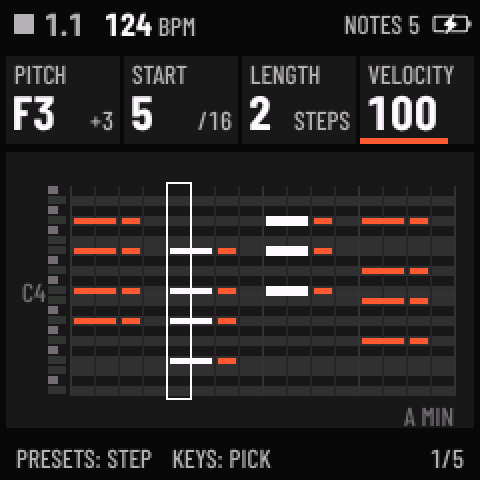<br><sub><b>NOTES</b>: the piano roll; the knobs move the selection, here step 5's chord, as one</sub></td>
<td width="33%">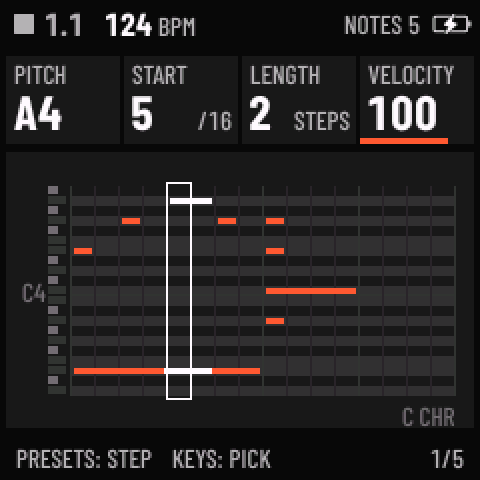<br><sub><b>Notes that overlap</b>: a long note under the line, each note its own length</sub></td>
<td width="33%">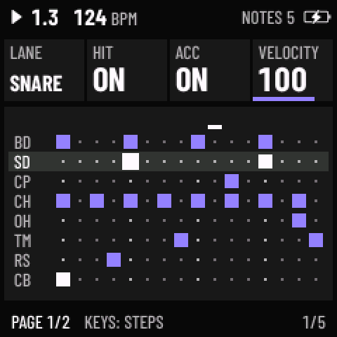<br><sub><b>Drum grid</b>: the kit's eight lanes, accents bright, the white keys the steps</sub></td>
</tr>
<tr>
<td>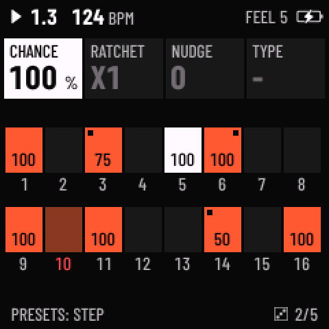<br><sub><b>FEEL</b>: sixteen tiles, each step's chance or condition, ratchet or FLAM, nudge, accent and slide</sub></td>
<td>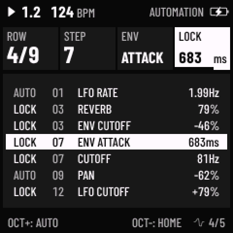<br><sub><b>AUTOMATION</b>: every recorded move and lock, to edit, move or delete</sub></td>
<td>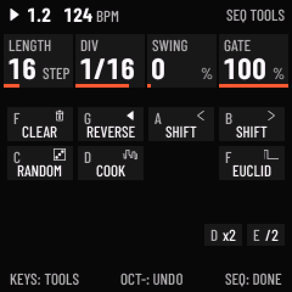<br><sub><b>SEQ TOOLS</b> (hold SEQ): clear, reverse, shift, random, cook</sub></td>
</tr>
</table>

### Patterns, songs and performance

<table>
<tr>
<td width="33%">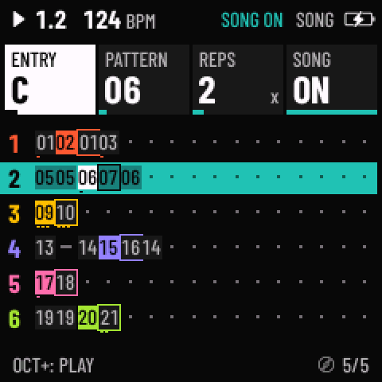<br><sub><b>SONG</b>: each track's list of entries, the one playing filled, the next outlined</sub></td>
<td width="33%">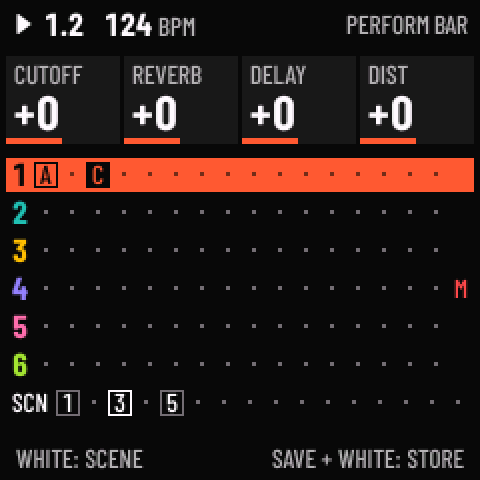<br><sub><b>PERFORM</b> (hold ARP): launch entries, stage mutes, recall scenes</sub></td>
<td width="33%">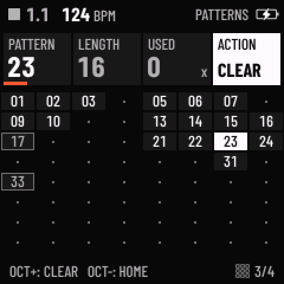<br><sub><b>PATTERNS</b>: the pool of 64, what uses each one</sub></td>
</tr>
<tr>
<td>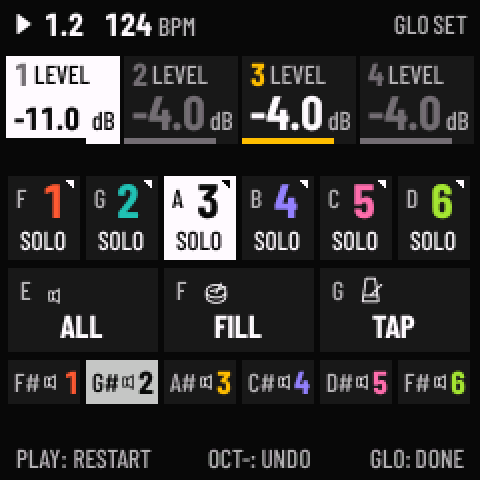<br><sub><b>GLO layer</b>: levels, solos, mutes, FILL, tap tempo</sub></td>
<td>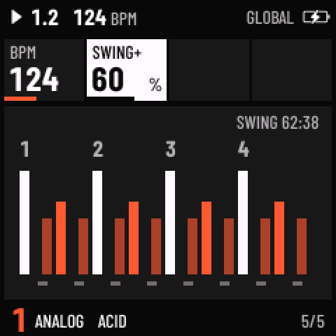<br><sub><b>GLOBAL</b>: tempo and swing, the swung steps drawn</sub></td>
<td>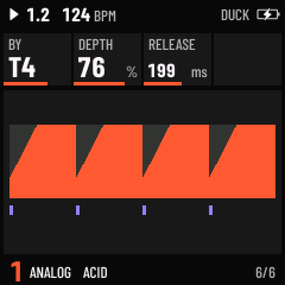<br><sub><b>DUCK</b>: a track dips under another's hits, the pump drawn over a bar</sub></td>
</tr>
<tr>
<td>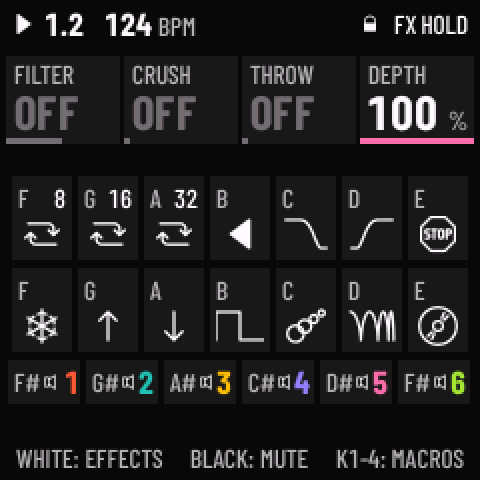<br><sub><b>FX layer</b> (hold FX): 14 effects on the white keys, an octave a row; the tracks' mutes on the black</sub></td>
<td>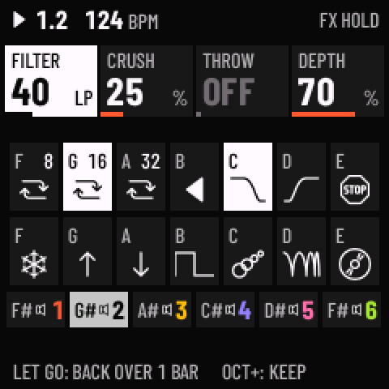<br><sub>Effects held, a repeat waiting for its sixteenth</sub></td>
<td>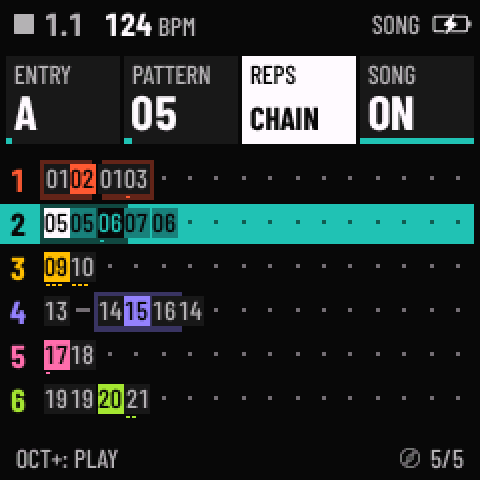<br><sub><b>Chains</b> (2.0): entries on CHAIN, one box each, played and edited as one pattern</sub></td>
</tr>
<tr>
<td>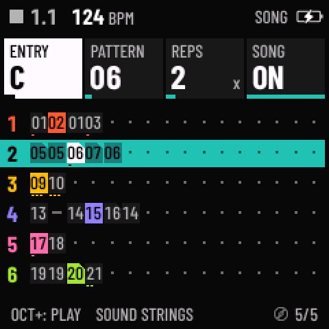<br><sub><b>An entry's sound</b> (2.0): its tile's corner cut off, the footer naming it; loaded as the track comes onto the entry</sub></td>
<td>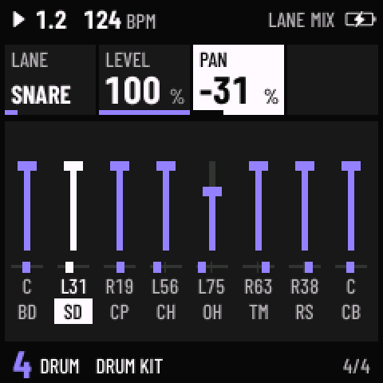<br><sub><b>LANE MIX</b> (2.0): each drum lane's level and pan</sub></td>
<td>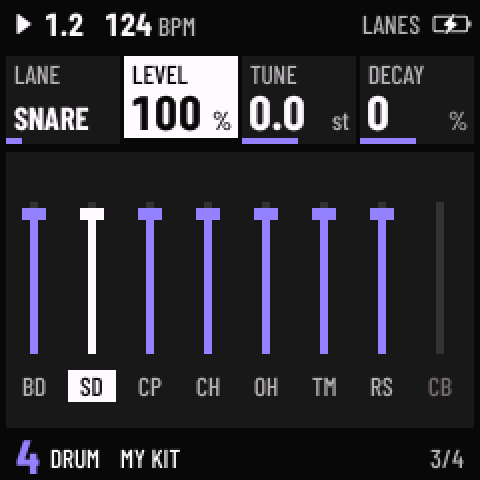<br><sub><b>Your own kit</b> (2.0): KIT USR1, the slot's samples on the lanes; BELL has none, dimmed</sub></td>
</tr>
</table>

### FM6 from scratch

EDIT › OPERATOR and ALL OPS put every value of an FM6 patch on the unit's knobs: PRESETS picks the operator, SELECT
its ratio, envelope, keyboard scaling, the algorithm, the pitch envelope and the LFO. INIT starts from a bare sine, and
SAVE › USER keeps the result as a sound of its own. The graph, after an idea by Floyd Steinberg, is the note as the
engine plays it: every operator's envelope, each carrier coloured along its length from cool (a sine) to hot (where
the modulators make it bite).

<table>
<tr>
<td width="25%">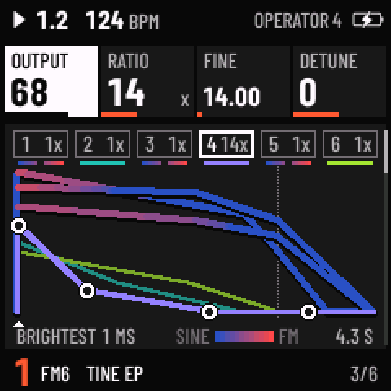<br><sub><b>OPERATOR</b>: OP4's ratio; the carriers hot where it bites</sub></td>
<td width="25%">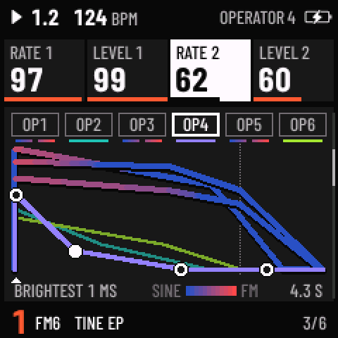<br><sub><b>ENV</b>: the stage being turned, a filled handle</sub></td>
<td width="25%">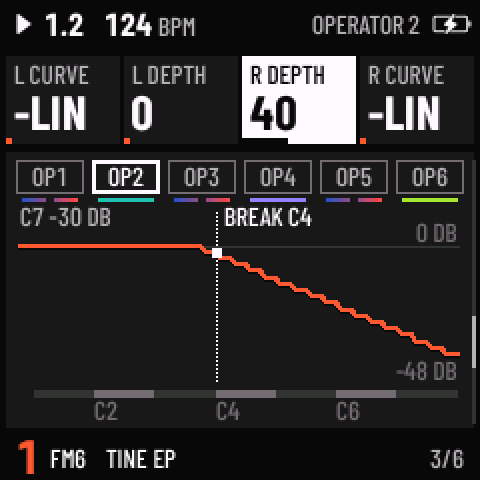<br><sub><b>KEYS</b>: the level across the keyboard</sub></td>
<td width="25%">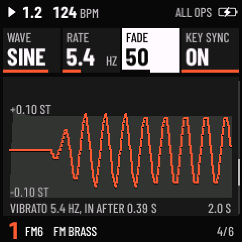<br><sub><b>ALL OPS</b>: the LFO's vibrato fading in</sub></td>
</tr>
</table>

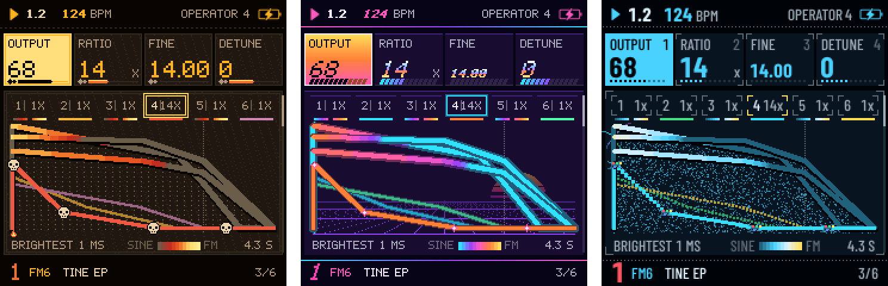

### Sound: every page draws what it does

<table>
<tr>
<td width="25%">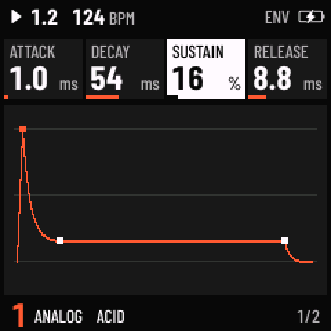<br><sub><b>ENV</b></sub></td>
<td width="25%">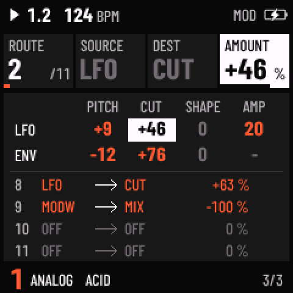<br><sub><b>MOD</b>: where the LFO and the envelope go, a grid over the four slots</sub></td>
<td width="25%">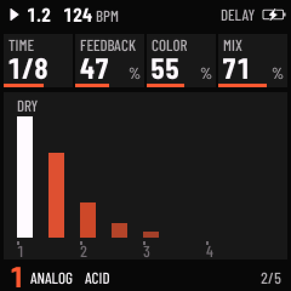<br><sub><b>DELAY</b>: the echoes</sub></td>
<td width="25%">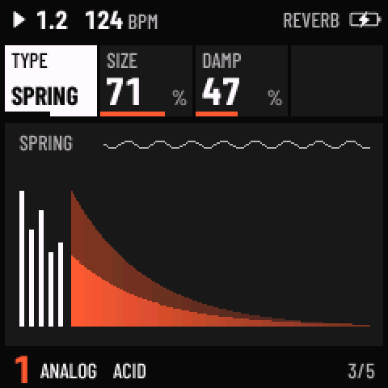<br><sub><b>REVERB</b>: SPRING's tail</sub></td>
</tr>
<tr>
<td>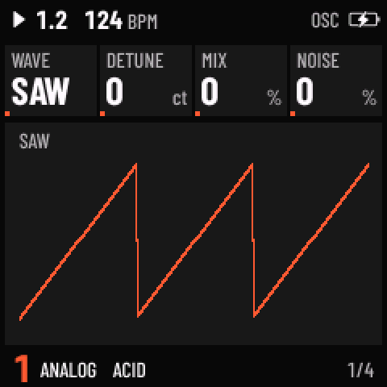<br><sub><b>ANALOG</b>: the oscillator</sub></td>
<td>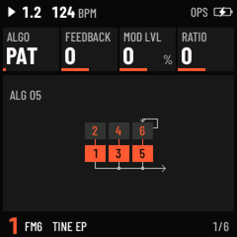<br><sub><b>FM6</b>: its algorithm</sub></td>
<td>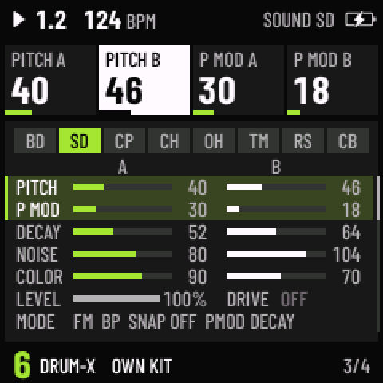<br><sub><b>DRUM-X</b>: a kit sound, A beside B</sub></td>
<td>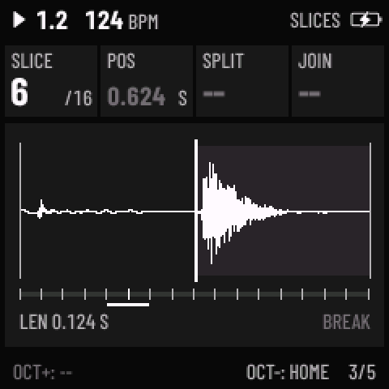<br><sub><b>SLICE</b>: the slices on the wave</sub></td>
</tr>
<tr>
<td>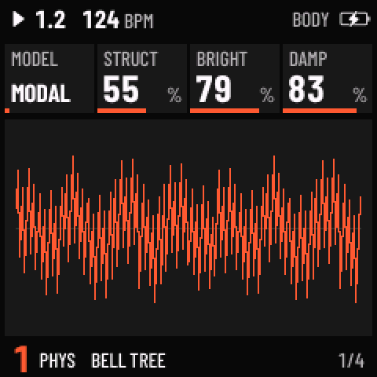<br><sub><b>PHYS</b>: the model sounding</sub></td>
<td>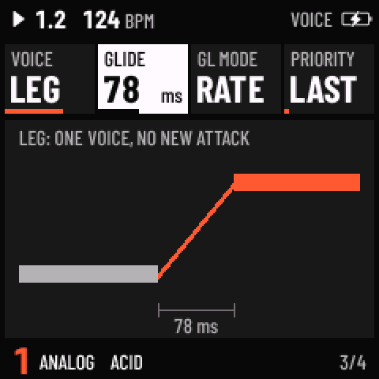<br><sub><b>VOICE</b>: legato and glide</sub></td>
<td>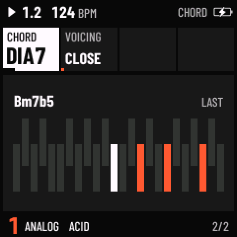<br><sub><b>CHORD</b>: the chord on the keys</sub></td>
<td>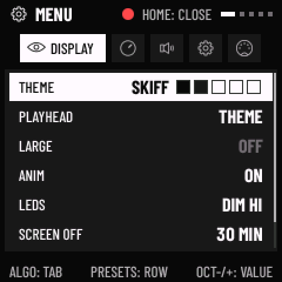<br><sub><b>MENU</b>: five tabs of settings</sub></td>
</tr>
<tr>
<td>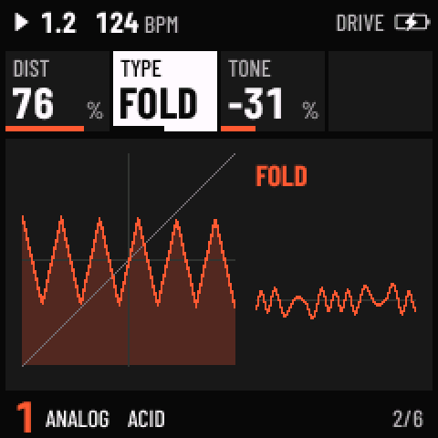<br><sub><b>DRIVE</b>: the TYPE's curve, a sine through it</sub></td>
<td>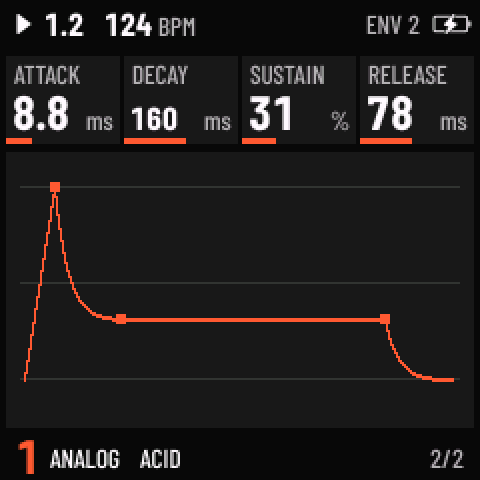<br><sub><b>ENV 2</b>: a second envelope, for the MOD matrix</sub></td>
<td>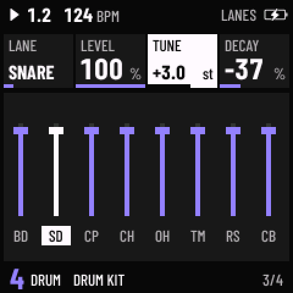<br><sub><b>LANES</b>: a drum lane's level, tune and decay</sub></td>
<td>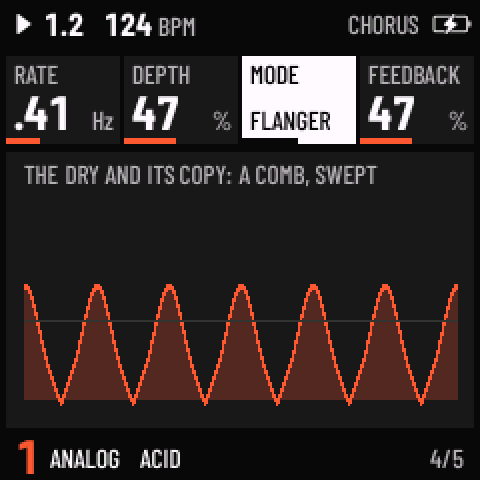<br><sub><b>CHORUS</b>: FLANGER's comb</sub></td>
</tr>
<tr>
<td>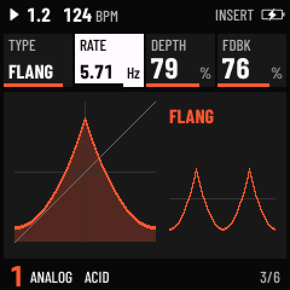<br><sub><b>INSERT</b> (1.3): FLANG's sweep</sub></td>
<td>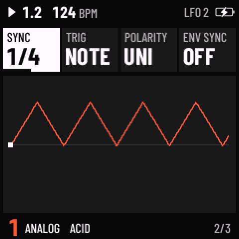<br><sub><b>LFO 2</b> (1.3): synced to 1/4, one-sided</sub></td>
<td>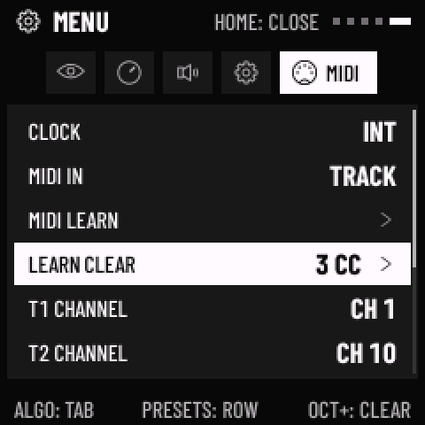<br><sub><b>MIDI</b> (1.3): LEARN, a channel per track</sub></td>
<td>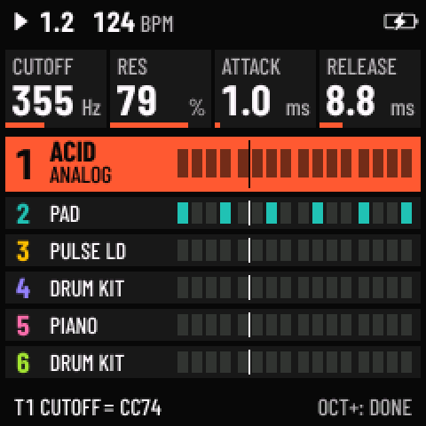<br><sub><b>MIDI LEARN</b> (1.3): a knob, then a CC</sub></td>
</tr>
</table>

### Themes

MENU › THEME: **SKIFF** (each track its own colour), **HI-CON**, **PAPER**, **CRYPT** (stone, amber and pixel letters,
the graphs as ASCII art, torches and skulls), **NEON** (synthwave: chrome numbers, neon, the striped sun and the grid,
a car on HOME's highway) and **QUARK** (particle physics: beams and collisions, nuclei, calorimeter towers):

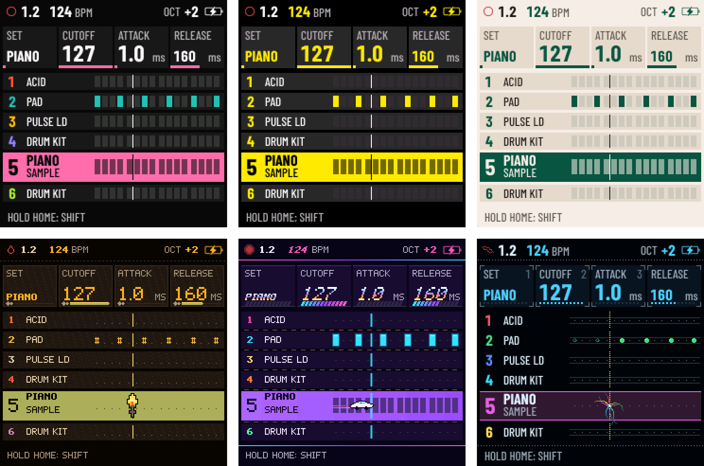

**CUSTOM** takes your own colours from the web editor (a theme's five and the six tracks'), in the look of any of
them. MENU › DISPLAY › PLAYHEAD LINE leaves HOME's playhead a line, without the torch, the car or the collision.

### The web editor

The [Skiff Editor](https://illuminus5.github.io/skiff/webapp/editor/) (`web/editor.html`, Chrome or Edge over USB MIDI)
edits a connected FM-1 live: the sounds and their presets, the steps, the mixer, the Song tab (each track's list, the
scenes, the pattern pool), the projects and their names, the DRUM-X kit and the MENU settings, with PLAY, STOP and REC
at the top. It looks like the unit and follows its THEME, and sets THEME › CUSTOM's colours (Settings › Device
display). It also keeps a library of sounds on the computer, imports
FM6 patches from `.syx` files and saves complete backups. Its Samples tab fills the user sample slots from WAV files
or a recording; (2.0) its Drum kit switch makes a slot a kit for DRUM: a WAV a lane, each with a level, the files'
levels to each other kept. On 2.0 its Restore converts a backup of before (Skiff 1.x,
Felucca) first, and lists what it converted.

<table>
<tr>
<td width="50%">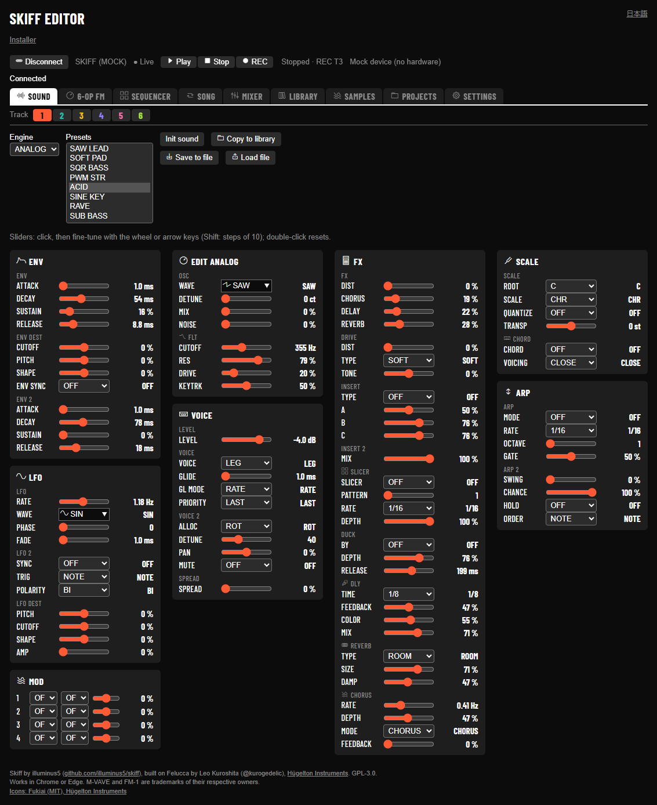<br><sub>The Sound tab: every parameter of the selected track</sub></td>
<td width="50%">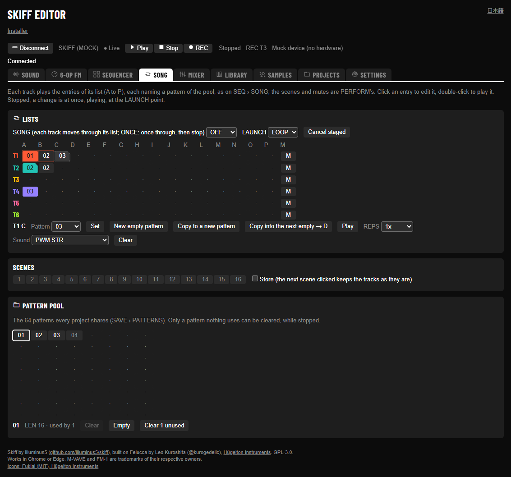<br><sub>The Song tab: the lists (a chain boxed, entries with a sound), the scenes, the pattern pool</sub></td>
</tr>
<tr>
<td>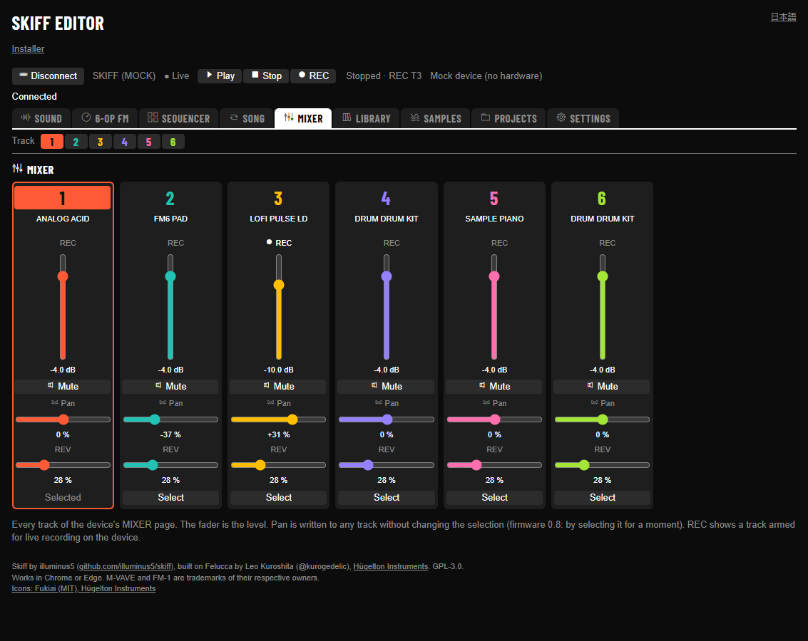<br><sub>The Mixer tab: the six strips</sub></td>
<td>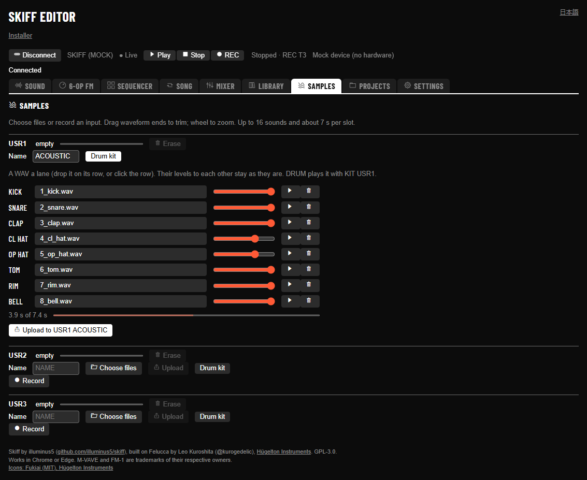<br><sub>The Samples tab (2.0): USR1 as a drum kit, a WAV a lane</sub></td>
</tr>
</table>

## Features

- **Six tracks**, each its own engine and sound; 8 voices shared between them, 12 with the FM-1's second core (MENU ›
  SYSTEM › CPU 2 CORES, BETA, 1.3). T5 and T6 play every engine but
  PHYS and GRAIN. ALGORITHM selects the track on every page; HOME, PERFORM, SONG and the MIXER show all six
- **Fourteen engines** (below), DRUM-X among them, each with at least 8 factory presets, 148 in all
- **Sounds by type** (1.2): every factory sound is a BASS, LEAD, PAD, KEYS, PLUCK, DRUM or FX sound; SAVE › PRESETS'
  LIST (KNOB 4) shows one type across every engine, and the PRESETS knob then steps through it on every page
  ([Find a sound by type](#find-a-sound-by-type))
- **FM6 from scratch** (1.1): every value of an FM6 patch on the unit (EDIT › OPERATOR and ALL OPS), INIT a bare
  sine, the sound saved as a user sound; the operators' envelopes drawn as they play, each carrier shaded by its
  brightness, in every theme's own look
- **Every page shows what it does:** the four knobs as cards across the top, and a graph of the page below:
  the envelope, MOD's routes as a grid, the delay's echoes, the reverb's tail, the swing grid, the glide,
  the oscillator and filter, the arpeggio. Hold **HOME** (SHIFT) and a map shows what every button, encoder
  and key does on that page
- **Sequencer:** 64 steps a track with chords, accent, slide, velocity, per-step chance and trig
  conditions (1:2, 3:4 ..), ratchets and **FLAM**, **NUDGE** (a step early or late, in 64ths), a step's own
  GATE, play direction (FWD, RVRS, PING, RAND); a drum grid (white keys steps, black keys lanes; a step's chance,
  ratchet and condition cover every hit on it); live loop recording with overdub, **FEEL** (recording keeps where
  you played), step recording, count-in and click. While playing, the step pages follow the playhead past step 16
  (1.3); MENU › STEP PREVIEW sounds the step the cursor lands on (1.3); QUANTIZE SEQ+T transposes the
  sequencer's notes by TRANSP before it snaps them to the scale (1.3)
- **NOTES and FEEL** (2.0): two step pages, PRESETS the cursor on both. SEQ › NOTES, the piano roll, edits a
  **selection** as one, the cursor's step or a range (SHIFT + PRESETS): PITCH (along the scale), START, LENGTH and
  VELOCITY. **Notes overlap**, each with its own length (1–99 % of a step, 1 STEP, or 2 to 128 steps): a long note
  goes on under the notes after it, a chord's notes can end apart, and REC and TAKE record them so; with REC off a
  key picks one note of a chord. **SHIFT + OCT− / OCT+** copy and paste the selection, **SHIFT + EDIT** deletes it
  (on the drum grid copy and paste follow the LANE: a figure moved from lane to lane). SEQ › FEEL, 16 tiles, sets
  CHANCE (OFF, 1–100 %, then the trig conditions), RATCHET (×1–4, FLAM), NUDGE and TYPE (accent, slide) on every
  selected step. A new note is 1 STEP long (PATTERN's GATE 100 %); PATTERN's PRESETS turns the direction
- **Patterns and songs:** 64 patterns shared by every project; each track has a list of 16 entries (A–P),
  each a pattern played REPS times; **SONG** plays each track down its list. Patterns keep themselves: no save
  needed. (2.0) Entries on **CHAIN** play and edit as one long pattern, **SONG ONCE** plays the lists once and stops,
  SONG's **NEW** and **COPY+** put a new or a copied pattern in the list in place, and an entry can carry a
  **sound** of its own, switched in on the entry's first step
  ([Patterns, lists and the song](#patterns-lists-and-the-song))
- **PERFORM** (hold ARP): launch any track's entries from the white keys, stage mutes on the black ones, on
  the next LOOP, BAR, BEAT or NOW (2.0: held, a black key cuts its track while it's held); 16 **scenes** (every track's
  entry and mute), SAVE held + a key stores one; throws on KNOB 1–4 (CUTOFF, REVERB, DELAY, DIST) that glide back over
  a bar (MENU › CONTROL › RETURN), or stay where they are with OCT+ (2.0)
- **TAKE** (SHIFT + SAVE): keep the last loop you played, notes and knob moves, on the track, after the fact
- **Undo:** SAVE held, 8 levels across the tracks (sound loads, takes, clears, tools, recording passes,
  automation edits); OCT− and OCT+ step through them while the undo box shows
- **Parameter locks and automation:** hold a step and turn a knob to lock it; knob moves recorded live; SEQ ›
  AUTOMATION lists them all to edit, move or delete
- **SEQ TOOLS** (hold SEQ): CLEAR, REVERSE, SHIFT < / >, RANDOM, COOK, and (1.3) EUCLID (hits spread over the steps,
  rotated; OCT+ applies), DOUBLE and HALF (the length and the steps with it); on a drum track BEAT and each lane's
  tools
- **MOMENTARY** (1.3): hold LFO and turn knobs on HOME, a sound page, an FX page or the MIXER: let go and the values
  come back (OCT+ keeps them), not recorded; (2.0) over a bar, or as MENU › CONTROL › RETURN says (SNAP, 1 BEAT,
  1 BAR), the same for FX's macros and PERFORM's throws
- **Lane mutes** (1.3): on a DRUM or DRUM-X track the EDIT layer's black keys 1–8 mute its lanes; OCT− puts them
  back as they were when the layer opened, and (2.0.1) OCT+ turns every lane on at once
- **DUCK** (FX › DUCK): a track dips under another track's hits, the sidechain pump
- **Effects:** per track DIST, in five types on FX › DRIVE (INSERT's SOFT, HARD, FOLD, CRUSH, FUZZ) with a TONE, and the SLICER;
  the buses on GLO: chorus (CHORUS, FLANGER or PHASER, with FEEDBACK), delay and reverb (ROOM, SPRING or a stereo
  HALL); the FX layer (hold FX): fourteen effects on the white keys and the tracks' mutes on the black ([the keys](#the-fx-layers-keys));
  new in 1.2: DRIVE's types and TONE, the chorus's modes, HALL, and GATE, DUB, FLANGE and VINYL on the FX layer;
  new in 1.3: **FX › INSERT**, a second effect per track after DRIVE (SOFT, HARD, FOLD, FUZZ, CRUSH, PHASR, FLANG or
  CHOR, its A, B and C named by the type, INSERT 2's MIX), and the delay's dotted times (1/8D, 1/16D, 1/4D)
- **Quick layers:** hold FX, GLO, SEL, EDIT, ARP or SEQ for its map on the keys and knobs; SHIFT + the button,
  or the button held + HOME (1.2.1), keeps it open. The GLO layer: solos, mutes, FILL, tap tempo
- **One mute** (2.0): the black keys F#3 to F#4 are the six tracks' MUTE in the GLO, FX and PERFORM layers alike: a
  tap mutes or unmutes the track (the MIXER's MUTE, saved; PERFORM's at its LAUNCH point), held the track is cut
  only while the key is. A muted track is silent at once, its sounding notes too
- **DRUM-X** (from [JIANT FM](https://github.com/juanjiant-bit/JIANT)): a synthesized kit of 8 sounds, each
  with an A and a B patch and MORPH between them, one kit per project, edited a sound at a time on EDIT › SOUND;
  eight kits come as presets (1.2), each loading its own (FACTORY, DEEP, CLICK, INDUSTRIAL, SOFT, GLITCH, TRIBAL, LASER)
- **Chord keys, arpeggiator, scales:** in-key chords with voicings; an arpeggiator with 14 modes, CHANCE,
  SWING and HOLD; 16 scales with a white-key mode; MONO, LEGATO, UNISON and glide
- **MOD** (2.0: one page, LFO › MOD): KNOB 1 picks the route, 1 to 11. The first seven are fixed, drawn as a grid:
  the LFO's depths to PITCH, CUT, SHAPE and AMP and the envelope's to PITCH, CUT and SHAPE (1.x's LFO DEST and ENV
  DEST pages), only their AMOUNT turning; routes 8 to 11 are the modulation matrix
- **Modulation matrix:** 4 slots a track; the sources the LFO, ENV and a second envelope of its own (ENV › ENV 2, 1.2),
  velocity, the key, a random value, MIDI controllers and (1.3) S&H and SLEW (a random value a cycle of the LFO,
  stepped or gliding); (1.3) the destinations DEPTH (the LFO's depth: MODW › DEPTH is a mod-wheel vibrato), and VEL
  and TIME to humanize: each note's velocity, each step a little late
- **LFO 2** (1.3): SYNC to a note value of the tempo (4 bars to 1/32), TRIG FREE (a note leaves its phase), POLARITY
  UNI (one-sided); **ENV SYNC** (1.3; LFO 2's fourth card since 2.0): ATTACK, DECAY and RELEASE as note values, 1/64T
  to 4 bars
- **SPREAD** (EDIT › VOICE 2, 1.3): a POLY or UNISON track's voices left and right of PAN in turn
- **Presets and projects:** factory presets, 32 user sounds and 4 projects, named on the device; SAVE › PROJECT
  loads, saves, renames and deletes them, and NEW on an empty slot starts a blank project (1.2.1); the music comes back at
  power-on (RESTORE LAST, an autosave of its own)
- **Screen and LEDs:** the BLOCKS look in Barlow Condensed with Fukiai icons; six themes; MENU › LARGE for tall
  cards; messages say the way out; idle buttons glow, what can be pressed breathes, never blinks
- **USB and MIDI:** class-compliant MIDI in and out, TRS MIDI in, a stereo USB audio input to record the
  master on a computer; channels 1–6 play tracks 1–6 (MENU › MIDI IN CH1-6), and (1.3) each track can listen on a
  channel of its own (MENU › MIDI › T1–T6 CHANNEL); clock from internal, USB or TRS. **MIDI LEARN** (1.3): MENU › MIDI
  › MIDI LEARN, turn a knob, send a CC: the controller sets that parameter, up to 10 of them; **Program Change** (1.3)
  loads the track's nth preset. **Standard CCs**, each on the track its channel plays (recorded as automation while it's
  armed): CC7 LEVEL, CC10 PAN, CC5 GLIDE, CC73 ATTACK, CC75 DECAY, CC72 RELEASE, CC74 the engine's brightness (ANALOG's
  CUTOFF ..), CC71 its resonance, CC91 REVERB, CC93 CHORUS, CC94 DELAY; CC1 mod wheel and CC11 expression (MOD sources),
  CC64 sustain

### Patterns, lists and the song

The notes live in **patterns**, and a project says which ones each track plays:

- **A pattern** is a track's notes exactly as they play: all 64 steps whole, each note's own length, LENGTH, DIV,
  SWING, GATE and DIR, and the track's automation and locks. The sound is not part of it. There are 64 of them,
  **01–64**, in one **pool** that every project shares (SAVE › PATTERNS); entries naming the same pattern share it,
  and COPY gives an entry its own (2.0: the first free number after its original's, so copies sit beside it).
- **SAVE › PATTERNS** shows the pool, what each pattern's LENGTH is and how many entries use it; KNOB 4, ACTION, is
  what OCT+ does (stopped, after asking): **CLEAR** a pattern nothing uses, **EMPTY** one (2.0: its notes and
  automation go, its number, its settings and the entries naming it stay) or **UNUSED** (2.0: every pattern nothing
  uses cleared at once).
- **Each track has a list** of 16 entries, A–P. An entry names a pattern (or none) and its REPS, the passes it plays
  (1–16). A track is always on one entry, and HOME, the SEQ pages and the keys edit that entry's pattern.
- **Nothing to save:** what a track has is kept as the pattern it is on, written to flash at the quiet autosave (and
  before a project save or load, or a backup).
- **SEQ › SONG** edits the lists: KNOB 1 the entry, KNOB 2 what goes in it (OCT+ puts it in, the footer saying
  what): REST, a kept pattern, **NEW** (2.0: a new empty pattern), **COPY** (a copy of the entry's pattern),
  **COPY+** (2.0: the copy into the first empty entry after it, this entry left as it is), CLEAR, then (2.0)
  **SOUND** (the track's sound now onto the entry: SET SOUND STRINGS) and **NO SOUND**; KNOB 3 the REPS
  (CHAIN, 1x–16x); KNOB 4 SONG (OFF, ON, ONCE).
- **An entry's sound** (2.0): when the track comes onto it, the entry loads its sound, as PRESETS or USER would (a
  program change): all but the track's own settings (LEVEL, PAN, MUTE, ARP, SCALE, the pattern's, the SLICER, the
  ducking). Playing, it switches on the entry's first step, with its pattern; stopped, at once. An entry without one
  leaves the sound as it is, so give the first entry one too to come back to it when the song loops. The sound is
  the preset or user sound as it was loaded: one edited since is refused (SOUND EDITED: save it on SAVE › USER
  first). A tile with a sound has its corner cut, and with nothing picked the footer names the entry's sound.
- **Playing an entry** (SEQ › SONG's OCT+, a PERFORM key, a scene, or a double-click in the editor) switches at once
  when stopped, and when playing at the **LAUNCH** point: the track's pass end (LOOP), the next BAR, BEAT, or NOW.
- **SONG ON:** while playing, each track moves to its next entry once the current one's REPS are played, at its own
  pass end; an empty entry between two patterns is a **rest**, silent for its REPS passes of the track's length
  (1.2.1); the empty ones after the last end the list, and after the last comes the first. KNOB 2 also picks
  **REST** for an entry anywhere in the list, so a track can start later or end sooner without an empty pattern. Tracks of different
  lengths move on at different times. **SONG OFF:** each track loops its entry. GLO + PLAY starts every track from
  its first entry. **SONG ONCE** (2.0): PLAY starts every track from its first entry, each plays its list once, then
  goes quiet, and when the last one ends the transport stops.
- **A chain** (2.0): KNOB 3 below 1x is CHAIN, the entry going on into the next. Entries on CHAIN with the one they
  end on are one pattern wherever the track plays them, each part with its own LENGTH, DIV and SWING: the header names
  the chain and the part (A-B · 02), NOTES counts the steps on through the parts (NOTES 71), and a note can go on from
  one part into the next (LENGTH, REC and TAKE across them). With SONG OFF a track loops the whole chain; with SONG
  ON or ONCE it plays the chain through, its last entry's REPS repeating all of it. A launch onto any part starts it
  from its first. An empty entry ends a chain.
- **Scenes** (16, in the project) keep the entry each track is on and every mute; SAVE held + a key stores one, a key
  recalls it, staged so that it all lands together.

## Controls


The black keys' legends are M-VAVE's: [docs/keystrip.pdf](docs/keystrip.pdf) is a strip to print (at 100 %) and lay
by the keys, with what each key is in Skiff.

- Tap a page button for its pages (again, or SELECT, for the next one); every family reopens the page you left
- **HOME** goes home. **Held**, it is SHIFT: its map shows what every control does on the page; let go alone,
  the MENU opens
- Hold FX, GLO, SEL, EDIT, ARP or SEQ for its layer; **SHIFT + the button** (or the button held, then HOME) keeps it open (the header says
  LOCKED), the button closes it. A locked FX layer latches its effects
- **SAVE** tapped: its pages (PRESETS, USER, PATTERNS, PROJECT); **held**: undo. **SHIFT + SAVE**: TAKE
- **REC** arms the selected track the moment it is pressed; on an armed track it disarms every track (its light is on
  while any track is armed). **SHIFT + REC** opens the REC layer:
  F3 held clears the track's sequence, then CLICK, COUNT-IN, CLICK LEVEL, FEEL
- **EDIT** opens the EDIT pages everywhere; on NOTES with REC armed it clears the cursor step
- **SELECT** turns the pages of a family; **GLO + SELECT** sets the tempo (MENU › BPM LOCK, on by default)
- **PRESETS** changes the sound; on NOTES and FEEL it moves the step cursor, on PATTERN it turns the direction, on
  lists it picks. With SAVE › PRESETS' LIST on a type (BASS, PAD ..) it steps through that type only
- On NOTES and FEEL, **SHIFT + PRESETS** stretches the selection over a range of steps, **SHIFT + OCT− / OCT+** copy
  and paste it, **SHIFT + EDIT** deletes it; with REC off a key picks its note in the selection
- On action pages and in dialogs, **OCT+** does it and **OCT−** goes back
- Hold a step on SEQ › NOTES (on the drum grid its white key; on the piano roll the step you are entering, REC armed
  and stopped) and turn KNOB 1–4 to lock those parameters on that step: the four of the sound page you were on last
  (HOME's after HOME)
- Save a sound: stop, tap SAVE (USER), pick a slot with KNOB 1, OCT+, name it with the keys, OCT+

### The FX layer's keys

Hold **FX** and press a key: its effect plays while the key is held (SHIFT + FX keeps the layer open, and then a key
latches its effect; a key still held as the layer locks stays on, latched). Effects of different kinds stack; of the
ones that play back what was just heard (REPEAT, REVERSE, TAPE STOP, FREEZE, OCT UP and DN, FLANGE, VINYL) the last
one pressed plays, and letting it go returns to the one held before.

| Key | Effect | Key | Effect |
| --- | --- | --- | --- |
| F3 | REPEAT 1/8 | F4 | FREEZE |
| G3 | REPEAT 1/16 | G4 | OCT UP: the mix an octave up beside itself |
| A3 | REPEAT 1/32 | A4 | OCT DN: an octave down |
| B3 | REVERSE | B4 | GATE: the mix chopped on the sixteenths |
| C4 | LPF: a low-pass closing over a bar | C5 | DUB: the mix into the delay, its feedback up; the echoes ring out after |
| D4 | HPF: a high-pass opening over a bar | D5 | FLANGE: a jet sweep, a bar each way |
| E4 | TAPE STOP | E5 | VINYL: a record's wow, a darker top, crackle |

REPEAT and REVERSE start on the next sixteenth. The black keys F#3, G#3, A#3, C#4, D#4 and F#4 are tracks 1–6's
mutes, as on GLO and PERFORM: a tap mutes or unmutes the track, held it is cut until you let go. KNOB 1–4 are the
layer's macros: FILTER (left a low-pass, right a high-pass), CRUSH, THROW (the mix into the delay and the reverb) and
DEPTH, how much of the effect you hear (with OCT UP or DN, its shimmer instead; with GATE, how deep it cuts). Let go
of FX and they come back over a bar (MENU › CONTROL › RETURN: SNAP, 1 BEAT or 1 BAR, as MOMENTARY's values and
PERFORM's throws); OCT+ with FX held keeps them.

## Engines

In the order the device lists them:

- **ANALOG**: virtual analog; two oscillators, noise, drive, resonant low-pass filter; (1.3) WAVE SYNC (a hard-synced
  saw the envelope sweeps) and SUB (a saw on a square an octave down)
- **FM6**: classic 6-operator FM (Dexed-based): 32 algorithms, a full patch per track, every value of it
  editable on the device (EDIT › OPERATOR and ALL OPS: the operators' envelopes drawn as they play, each
  carrier shaded by how bright the modulators make it) or in the web editor (which imports .syx files);
  INIT starts from a bare sine; macros on the device, an algorithm chart; SLOT picks a factory patch
  (F1–F8) or the track's own (OWN)
- **PHASE**: phase distortion (ported from CrispyZebra); (1.3) FOLD, a wavefolder
- **LOFI**: chiptune; pulse, triangle, saw, noise and a 4-bit wave RAM, stepped envelope, sweep, arpeggio
- **SAMPLE**: multisampled instruments and 3 user sample slots, each sample with its own level, reverb and delay
  (EDIT › SAMPLES)
- **VOICE**: formant oscillator, sung vowels
- **TRIO**: 3 oscillators with ring modulation and sync, multimode filter
- **WHEEL**: tonewheel-style organ; drawbar registrations, percussion, key click, drive, rotary speaker
- **GRAIN**: granular textures from the built-in samples or a user slot
- **PHYS**: physical models: modal resonators, strings, struck membranes, sympathetic strings
- **NOISE**: noise from analog to digital: colours, crackle, shift-register and metallic tones
- **SLICE**: two drum breaks, a piano note (all built in) or your own sample cut into slices, one per key;
  set the slices by hand on the SLICES page
- **DRUM**: an 8-lane kit of Felucca's own drum voices on the General MIDI key map. KIT picks the
  standard kit or one of five virtual-analog (VA) kits in the manner of
  classic analog drum machines (the numbers are a hint), every lane its own voice: **80** (deep sine kick with a long decay, noisy snare,
  six-square hats), **10** (swept kick, white-noise snare, long-tailed claps, a cymbal), **66** (soft
  round kick, bright snare, noise hats, a conga), **55** (dropping kick, high metal hats, a metal bell)
  and **77** (swelling kick, multi-burst claps, claves, a cymbal), and (1.3) **DEEP**, **TIGHT** and **PERC**, put
  together from those five's pieces. All of them are synthesized, no samples, and
  each has presets (BOOM KIT, CRISP KIT, RHYTHM BOX, ELECTRO KIT, STUDIO KIT ..). EDIT › LANES sets each lane on its
  own: KNOB 1 the lane, KNOB 2 its level, KNOB 3 its tune (±12 semitones), KNOB 4 its decay (0 as the kit has it);
  (2.0) EDIT › LANE MIX, on DRUM and DRUM-X, its level and **PAN** (KNOB 1 the lane, or a key struck): a lane panned
  as the track's PAN pans, the track's PAN over the whole kit, DRIVE, the INSERT and the sends hearing the kit as
  before. (2.0) KIT **USR1**–**USR3** plays a user sample slot as the kit: each lane its sample on its key (KICK
  C2, SNARE D2, CLAP D#2, CL HAT F#2, OP HAT A#2, TOM A2, RIM C#2, BELL G#3), with the lanes' level, tune, decay and pan,
  the open hat cut by the closed one; a lane with no sample is silent. The editor's Samples tab builds such a slot
  (Drum kit: a WAV a lane)
- **DRUM-X**: a synthesized 8-sound kit from [JIANT FM](https://github.com/juanjiant-bit/JIANT), after the idea of
  Sonic Charge's Microtonic: each sound an oscillator (SIN, FM, MTL, BEL) with a pitch envelope and filtered noise,
  two patches A and B with MORPH between them; one kit a project, edited on EDIT › SOUND, a sound at a time. Its
  presets FACTORY KIT, DEEP KIT, CLICK KIT, INDUSTRIAL, SOFT KIT, GLITCH KIT, TRIBAL KIT and LASER KIT each load a
  kit of their own (SAVE held brings the one before back); OWN KIT and HADRON KIT keep the project's kit

**SLICER** (FX › SLICER, every track): a tempo-synced 16-step gate or stutter, with 16 patterns.

<details>
<summary><b>Notes for Felucca users</b></summary>

The DIGITAL engine of Felucca 0.9 became FM6: projects and presets with DIGITAL sounds load as FM6 sounds converted
from them. The SAMPLE engine's PERC kit was removed in Felucca 1.0.2: sounds and projects that used it load as the
DRUM engine's kit, on the same key map. FM6's patch bank (the B slots) was removed in 1.0.3: user presets keep their
own FM6 patch. SLICE gained a second built-in sound in 1.0.4, PIANO, next to BREAK; this version a new BREAK (one bar
at 120 BPM) and FUNK (SOURCE 5: two beats at 86 BPM), both made with the YuE2 music model. A missing sample (an empty user
slot) plays a plain sine at the note's pitch on SAMPLE, GRAIN and SLICE, and the screen says NO SAMPLE once. DRUM's
KIT variants HAND, CYM and H+CYM were retired in 1.0.5: sounds and projects that used them play the 66, 10 and 77
kits. Felucca's projects become Skiff's at the first start: each track's steps a pattern on its entry A.
</details>

<details>
<summary><b>Going back to Skiff 1.1</b></summary>

Projects, patterns and sounds saved with this version open on Skiff 1.1, without what 1.1 doesn't have: DIST's TYPE
and TONE (it plays SOFT), ENV 2's settings, the drum lanes' TUNE and DECAY, the chorus's MODE and FEEDBACK (it plays
CHORUS); a HALL reverb plays as SPRING. A MOD slot whose source is ENV2 becomes EXPR there, which with no MIDI
expression coming in is its whole amount all the time: set it OFF on 1.1. Saving there leaves the new settings out for
good. A pattern with automation on one of them keeps its steps and its other automation. A track on a sound added in
this version keeps playing it as it was saved, under the name of one of 1.1's sounds. SLICE's FUNK plays PIANO there,
and BREAK 1.1's own break.
</details>

## Menu

Hold **HOME** and let it go for the menu. It is in five tabs: **DISPLAY** (THEME, PLAYHEAD, LARGE, ANIM, LEDS,
SCREEN OFF, HINTS), **CONTROL** (HOLD, KNOB ACCEL, BPM LOCK, SCALE LEDS, STEP PREVIEW, RETURN), **AUDIO** (SPEAKER EQ,
USB LEVEL, CLICK, CLICK LEVEL, COUNT-IN, TUNE), **SYSTEM** (RESTORE LAST, CPU, CPU CLOCK, HARDWARE CALIBRATION, RESET
SETTINGS, ABOUT) and **MIDI** (CLOCK, MIDI IN, MIDI LEARN, LEARN CLEAR, T1–T6 CHANNEL); a tab of more than six rows
scrolls.
ALGORITHM moves between the tabs and PRESETS through the rows of one; any of KNOB 1–4, or OCT+ / OCT−,
changes the value (OCT+ opens HARDWARE CALIBRATION and ABOUT, starts MIDI LEARN and clears what it learned); press
HOME to close the menu. RESET SETTINGS puts
every setting back as a new unit has it. The web editor's Settings tab reads and changes them too.

<details>
<summary><b>Every setting</b></summary>

- **THEME:** SKIFF (each track its own colour), HI-CON (high contrast), PAPER (light), CRYPT (a dungeon synth's:
  stone, amber, pixel letters, the graphs as ASCII art, torches and skulls), NEON (synthwave: chrome numbers, neon,
  the striped sun and the grid, a car on HOME's highway) or QUARK (particle physics: beams and collisions, nuclei,
  calorimeter towers, the tracks the colour charges); the web editor follows it; and CUSTOM, last, once the web
  editor has stored colours of your own (1.4). A unit on a palette of before that is gone (GREY, GREEN, AMBER, ICE,
  VIOLET, ROSE, NIGHT, MONO) starts on SKIFF
- **PLAYHEAD** (1.4): THEME (default) or LINE: HOME's playhead a plain line, without the theme's torch, car or
  collision
- **LARGE:** OFF or ON: on HOME and the value pages the four knob cards grow tall, marked K1–K4, with
  larger labels and values about twice the size; the graph below becomes a strip. Lists, the piano roll,
  the drum grid and the quick layers keep their layout with larger labels
- **ANIM:** ON or OFF; OFF shows every change at once, without rolling digits, a gliding piano roll or
  the LED sweep at power-on
- **LEDS:** OFF (no glow), DIM LO, DIM HI (default) or INV (the idle LEDs lit, the active ones dark).
  What can be pressed breathes up to about 60 % of a lit LED, about 30 % with DIM LO
- **SCREEN OFF:** NEVER, 5 MIN, 15 MIN, 30 MIN (default) or 60 MIN: after that long with no button, key or
  knob touched, the screen and its backlight go off; the sound, the sequencer, MIDI and USB go on. The next
  button, key or knob only turns the screen back on (PLAY still stops the music). Never while the music
  plays
- **HOLD:** how long a button is held before its hold acts (the layers, SAVE's undo, HOME's SHIFT)
- **KNOB ACCEL:** OFF (one step per click) or ON: a fast, steady turn of a wide value moves 2 to 4 steps
  per click, up to 8 on values of more than 64 steps, the FX and GLO layers' knobs included; lists never
  jump. ON or OFF, every click of a fast turn counts
- **BPM LOCK:** ON (default), SELECT turns the pages of a family; hold GLO and turn SELECT, tap G4 in the GLO
  layer or use GLO › GLOBAL for the tempo. OFF, SELECT is the tempo everywhere, Felucca's way. Skiff turns it
  ON once on a unit coming from Felucca; DRUM-X's SOUND sheet and FM6's OPERATOR and ALL OPS move their rows with
  SELECT either way
- **SCALE LEDS:** OFF or ON: the keys show the selected track's scale all the time (the root a little
  brighter); not on DRUM or SLICE tracks
- **CLOCK:** INT, USB or TRS, where the tempo comes from. **MIDI IN:** CH1-6, channels 1–6 play tracks 1–6 (TRACK
  once one of them is set to another channel), or SEL, every channel the selected track. **TUNE** (AUDIO): the whole
  unit in cents, ±50. The three are the unit's, so loading a project never changes them
- **T1–T6 CHANNEL** (MIDI, 1.3): the channel each track hears and its keys play out on, CH 1–16 (CH 1–6 by default); two
  tracks on one channel: the first of them plays it, and a channel no track is on is left for other instruments
- **MIDI LEARN** (MIDI, 1.3): OCT+ turns it on and closes the menu. Turn a knob (on HOME, a sound page, the MIXER, the
  GLO layer's levels): the footer says what it picked; send a CC from your controller and it is learned to that
  parameter of that track. Turn the next knob for another; OCT− clears the picked one's CC, OCT+ is done. Up to 10 CCs,
  on any channel MIDI IN hears; a CC learned no longer reaches the standard map (CC7 LEVEL, CC74 the brightness ..).
  CC1, 6, 11, 32, 38, 64, 96–101 and 120–127 are never learned. **LEARN CLEAR** forgets them all
- **STEP PREVIEW** (CONTROL, 1.3): ON, a move of the cursor on NOTES or the drum grid (PRESETS, the grid's page keys)
  sounds the step it lands on, when stopped
- **RETURN** (CONTROL, 2.0): SNAP, 1 BEAT or 1 BAR (default): how MOMENTARY's values (LFO held + a knob), the FX
  layer's macros and PERFORM's throws come back, at once or in a line over that time; OCT+ keeps them instead
- **CPU** (SYSTEM): **1 CORE** (default) or **2 CORES (BETA)**, then how busy the audio is. 2 CORES takes effect
  at the next power-on: stop playing first (the row says STOP while the music plays, since settings are saved
  stopped), then restart when it says RESTART: the FM-1's second core renders some of the tracks of
  every block, the sound bit for bit the same, and up to 12 voices sound at once instead of 8. If the second core
  misreads or stops answering (some units do), the FM-1 goes on with one core, says CORE 2 FAILED and sets the row
  back to 1 CORE
- **CPU CLOCK** (SYSTEM, 1.3.1): **360 MHZ** (default: what the FM-1's boot sets) or **320 MHZ**, the clock JieLi rates
  the chip for (curist's switch, no voltage changed). It takes effect at the next power-on, as CPU does (STOP, then
  RESTART). 320 is about 11 % slower: the same music shows a higher CPU. A unit whose clock is set up differently
  refuses it and says why (NO 320 MHZ: ...). ABOUT shows the clock the FM-1 runs at
- **HINTS** (DISPLAY): ON or OFF; OFF drops the one line of hint (HOLD HOME: SHIFT, KEYS: STEPS, a layer's
  first HOLD [X]: SHORTCUTS) and SHIFT's map; what OCT+ and OCT- do on an action page stays
- **RESET SETTINGS** (SYSTEM): OCT+ asks, then puts every MENU setting back as a new unit has it (the channels too, and
  nothing learned); the calibration, the favourite sounds and the music stay
- **SPEAKER EQ:** FLAT, LOWCUT or BASS+, a tone setting for the built-in speaker (not a switch). It also
  shapes the headphone out and USB audio, so keep it on FLAT when recording. The firmware cannot turn
  the speaker off, but headphones in the jack do
- **USB LEVEL:** MASTER (the MASTER knob sets the USB audio level too) or FIXED (USB always at full
  level, MASTER sets only the speaker and headphones)
- **CLICK:** OFF (default), REC (while a track is armed) or ON: a click on every beat while playing, the
  bar's first beat higher. **CLICK LEVEL:** LOW, MID (default) or HIGH; MASTER sets it too
- **COUNT-IN:** OFF (default), 1 BAR or 2 BARS: with a track armed, PLAY counts in first (clicking even with
  CLICK OFF), and a note played in the last half beat lands on step 1. Not with an external clock
- **USB SERIAL** (2.0: only in a build from source without `--release`, see [BUILDING.md](BUILDING.md)): the serial
  console, a developer tool. A release has none, so the FM-1 is a plain audio + MIDI device and macOS 13–15 see its
  USB audio input
- **RESTORE LAST:** ON (default) or OFF. ON, the FM-1 starts with the music you left (the header says
  RESTORED), kept in an autosave apart from the four projects; it is written when the music changed, the
  transport is stopped and nothing has been touched for 2 s, at most once every 20 s (2.0; 1.x: 10 s, once a minute,
  for the flash's sake), and within a second of a save (SAVE › USER or PROJECT) or a project load. Switch off a few
  seconds after your last change, or right after a save. OFF starts with the power-on sounds
- **HARDWARE CALIBRATION** and **ABOUT** (the version, the credits and a QR code to this repository)
</details>

## Scale keyboard

On the **SCALE** page (the **SEL** button), set **QNT** to WHITE to play the selected scale using only the white keys (SNAP keeps every key
and rounds it down to the scale). C4 plays **ROOT**; consecutive white keys play consecutive scale notes above and
below it. Black keys are silent, including during live recording and step entry. **TRN** transposes the resulting
notes; the octave buttons shift them by full octaves. Set QNT to OFF for the normal chromatic keyboard. QNT SEQ snaps
the keys like SNAP and also maps the sequenced notes onto the current ROOT / SCALE as they play (the steps are not
changed; drum kits are never quantized).

Scales: chromatic (CHR), major (MAJ), natural minor (MIN), Dorian (DOR), Mixolydian (MIX), major pentatonic (PEN),
minor pentatonic (MPEN), harmonic minor (HARM), Phrygian (PHRY), Lydian (LYD), Locrian (LOC), ascending melodic minor
(MEL), minor blues (BLUES), whole tone (WHOLE), half-whole diminished (DIMHW) and whole-half diminished (DIMWH). Scales
with other than seven notes continue across the white keys without repeating notes. Drum kits and incoming MIDI keep
their own note mapping. Press **SEL** again for the **CHORD** page: CHRD picks the chord keys (OFF, the scale's triads
or sevenths, or a fixed shape) and VOIC the voicing.

## Build from source

[BUILDING.md](BUILDING.md): the toolchain, the JieLi AC79 SDK the package needs three files from, `./build.sh`
(writes `build/felucca.fwsc`) and `tests/run_tests.sh`, the host tests every change keeps passing. How every screen
and control behaves, rule by rule: [DESIGN.md](DESIGN.md). The editor's protocol:
[web/EDITOR_PROTOCOL.md](web/EDITOR_PROTOCOL.md). Contributions: [CONTRIBUTING.md](CONTRIBUTING.md).

**M-VAVE SMK-37:** `BOARD=smk37 ./build.sh` (`MODEL=elite`, `MODEL=mke` for the other two names): see
[SMK37.md](SMK37.md).

| Path | What |
| --- | --- |
| `firmware/` | firmware sources: `src/` app, `hal/` hardware layer, `loader/` update loader |
| `tools/` | build script, generators, package maker, installer and sample uploader |
| `assets/` | UI fonts, icon names, CC0 instrument samples |
| `web/` | the web installer, the editor (`editor.html`, its protocol `EDITOR_PROTOCOL.md`) and the browser emulator (`web/emu/`) |
| `design/` | the mockups the looks were chosen from, the logo's generator |
| `tests/` | tests that run on the build machine |
| `docs/` | the README's pictures, the logo, the controls card and key strip |
| `LICENSES/` | licence texts of the bundled fonts, icons, ported DSP and SDK files |

## If the FM-1 does not start

On the SMK-37: [SMK37.md](SMK37.md#if-it-does-not-start).

**The screen says UPDATE MODE, or stays black while a computer sees a USB MIDI device named "Felucca
Update":** an install was cut off, and the FM-1 waits in Skiff's update loader at every power-on. Nothing is
lost. Connect it by USB and run the [Skiff installer](https://illuminus5.github.io/skiff/webapp/installer/) again
(or `python tools/fm1_install.py skiff-2.0.2.fwsc`): it finishes the install. If the installer can't find it, plug
the FM-1 straight into the computer: a USB hub or USB-sharing software can lose it when it switches to update mode.
M-VAVE's own updater does not see the FM-1 in this state. (Since 1.3.2 the loader says UPDATE MODE on the screen;
one an older Skiff left there keeps it black.)

**A computer sees a USB disk named WL82 UBOOT1.00** (or WL80UBOOT, a USB mass-storage device with ID 4C4A:8057):
that is the chip's built-in boot mode, and the FM-1 can be brought back:

- First try another USB data cable, and close every other app that uses MIDI, then run `tools/fm1_install.py`
  again: it finishes an interrupted update.
- If it stays in boot mode, [FM-1 Transporter](https://github.com/kurogedelic/FM-1-transporter) reads and
  writes the FM-1's flash from a Mac through a Seeed XIAO RP2040 (three wires to the FM-1's USB lines). Back up
  the flash first, then write the official firmware (M-VAVE's FM-1.fwsc). On Windows and Linux,
  [jl-uboot-tool](https://github.com/kagaimiq/jl-uboot-tool) reads and writes it over the same USB cable, as
  [SMK37.md](SMK37.md#back-up-first) describes for the keyboard (the FM-1's flash is 1 MiB too).

**A computer sees nothing at all:** try another USB cable (a charge-only cable has no data lines) and another
port, with the FM-1 charged, then restart the computer: Windows can leave a USB port dead after a device in boot
mode goes away. FM-1 Transporter (above) reaches the chip's boot mode by itself.

## Support

Skiff stands on Felucca. If it is useful to you, support Felucca's author:
[sponsoring on GitHub](https://github.com/sponsors/hugelton) or a donation on
[itch.io](https://hugelton.itch.io/felucca).

## Credits

- **[Felucca](https://github.com/hugelton/Felucca)** by **[Hügelton Instruments](https://hugelton.com)** (Leo
  Kuroshita, [@kurogedelic](https://github.com/kurogedelic)): the firmware Skiff is built on, and in 1.3 the features of its
  1.2 to 1.6.1 (LFO 2, the INSERT, MIDI LEARN and the channels, SPREAD, ENV SYNC, the MOD additions, EUCLID, and more); the PHASE engine's waveforms (a C port of the oscillator of
  [CrispyZebra](https://github.com/hugelton/CrispyZebra), GPL-3.0); the DRUM voices and kits; the Hügelton Sample
  Pack (the drum samples, GPL-3.0-only, not CC0); the [Fukiai](https://github.com/hugelton/Fukiai) icon
  font ([MIT](LICENSES/MIT-Fukiai.txt))
- Fonts: [Barlow Condensed](https://github.com/jpt/barlow) by The Barlow Project Authors (the screen and the editor),
  [SIL OFL 1.1](LICENSES/OFL-BarlowCondensed.txt); [Inter Tight](https://github.com/rsms/inter-tight) by The Inter Project Authors (the control card), [SIL OFL 1.1](LICENSES/OFL-InterTight.txt);
  the browser emulator's labels: [DotGothic16](https://github.com/fontworks-fonts/DotGothic16) by The DotGothic16 Project Authors, [SIL OFL 1.1](LICENSES/OFL-DotGothic16.txt)
- Samples: [Versilian Studios](https://versilian-studios.com/) [VSCO-2 Community Edition](https://github.com/sgossner/VSCO-2-CE) and [VCSL](https://github.com/sgossner/VCSL), CC0 1.0: the SAMPLE sets, also SLICE's PIANO ([attribution](assets/samples-cc0/ATTRIBUTION.txt))
- SLICE's BREAK and FUNK: made with [YuE2](https://github.com/multimodal-art-projection/YuE) by Multimodal Art Projection ([how](assets/breaks/ATTRIBUTION.txt))
- VOICE engine: after [klattsch](https://github.com/tgies/klattsch) by Tony Gies (MIT); formant data from Klatt (1980) and Hillenbrand et al. (1995)
- PHYS engine: models ported from [DaisySP](https://github.com/electro-smith/DaisySP) by Electrosmith and Emilie Gillet ([MIT](LICENSES/MIT-DaisySP.txt)) and from Emilie Gillet's [eurorack](https://github.com/pichenettes/eurorack) code ([MIT](LICENSES/MIT-Rings.txt))
- FM6 engine: msfa from [Dexed](https://github.com/asb2m10/dexed) by Google Inc. and Pascal Gauthier ([Apache-2.0](LICENSES/Apache-2.0-msfa.txt))
- DRUM-X engine: from [JIANT FM](https://github.com/juanjiant-bit/JIANT) by [juanjiant-bit](https://github.com/juanjiant-bit) (GPL-3.0-only), after the idea of Sonic Charge's Microtonic
- Browser emulator: after [X0X](https://github.com/charlesvestal/fm1-x0x) by [charlesvestal](https://github.com/charlesvestal) (GPL-3.0), a Felucca fork whose browser build showed the way
- Second core: as [Felucca](https://github.com/hugelton/Felucca) 1.6.1 has it, its start code from [X0X](https://github.com/charlesvestal/fm1-x0x),
  after [Melodee](https://github.com/keremimo/melodee) by [keremimo](https://github.com/keremimo) and with
  [Jangada](https://github.com/zednaked/jangada)'s measurements and hardening by [zednaked](https://github.com/zednaked) (all GPL-3.0);
  its host tests by gospodindilly-ops
- 320 MHz (MENU › SYSTEM › CPU CLOCK): the switch from [fm1-clk320-probe](https://github.com/curist/fm1-clk320-probe)
  by [curist](https://github.com/curist) ([MIT](LICENSES/MIT-fm1-clk320.txt)), after the JieLi AC79 SDK's clock code (Apache-2.0)
- The SMK-37 build: the board layer of [genkigenki](https://github.com/genkigenki)'s SMK-37 port of
  [Felucca](https://github.com/genkigenki/Felucca) (GPL-3.0-only: the input, screen, pad LED, flash map, update and
  installer parts), and the SMK-37 hardware notes of their [fm1-to-smk37](https://github.com/genkigenki/fm1-to-smk37) kit
- Package format and boot files: [JieLi AC79 SDK](https://gitee.com/Jieli-Tech/fw-AC79_AIoT_SDK) ([Apache-2.0](LICENSES/Apache-2.0.txt); three of its files are in every package, none in this tree)
- Contributions to Felucca: [keremimo](https://github.com/keremimo) (white-key scales, #2), [ChanceTheMaker](https://github.com/ChanceTheMaker)
  (TRS MIDI, bend, sustain and clock, palettes, favourites, editor display settings: #8, #10, #11, #12),
  [andreahaku](https://github.com/andreahaku) (sample recording and trim, #29; SLICE manual slices and tests, #27, #22),
  [spinkham](https://github.com/spinkham) (the boot fix for 0.9 projects, #111),
  [zednaked](https://github.com/zednaked) (ratchets, #100),
  [jasonpersinger](https://github.com/jasonpersinger) (the ROOM reverb click fix, #121),
  [renebohne](https://github.com/renebohne) (MIDI Program Change, #179)

## Licence

Free software: [GPL-3.0-only](LICENSE), the Hügelton Sample Pack included. Skiff is a modified version of
Felucca; its changes are marked (Skiff) in the sources. The bundled fonts and the ported DSP keep their own
licences ([LICENSES/](LICENSES/)); details in [LICENSING.md](LICENSING.md).

M-VAVE, FM-1 and SMK-37 are trademarks of their respective owners. Skiff and Felucca are not affiliated with or endorsed
by them, and Skiff is not made or endorsed by Hügelton Instruments.

Copyright (C) 2026 Leo Kuroshita (@kurogedelic), Hügelton Instruments (Felucca)<br>
Copyright (C) 2026 illuminus5 (Skiff)
